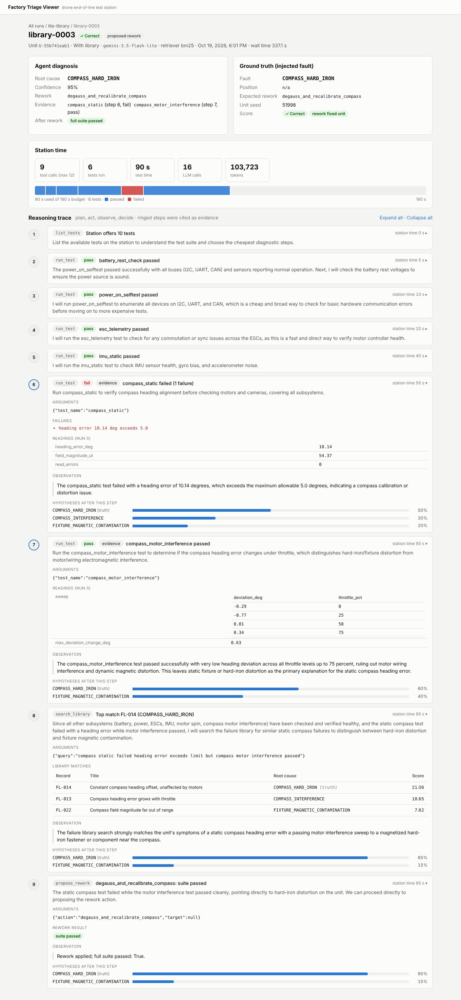
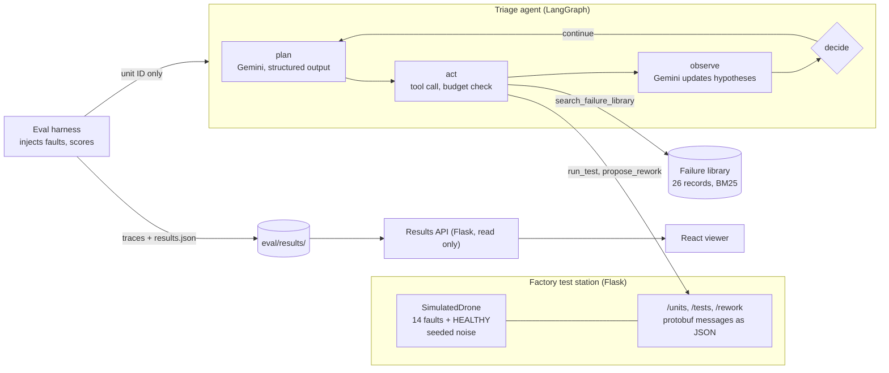
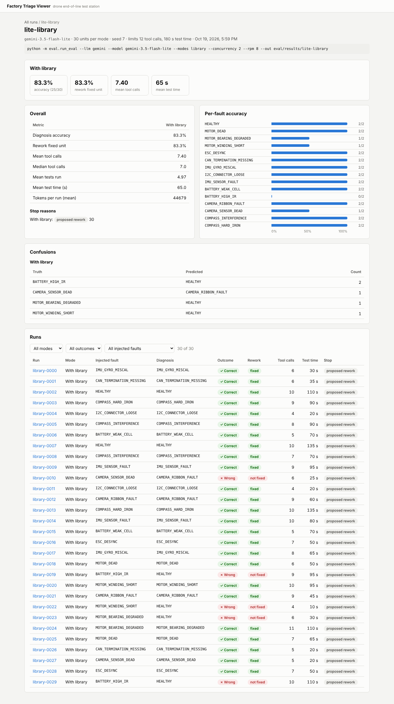

# Factory Triage Agent

A simulated drone factory end-of-line test station, and an LLM agent that diagnoses the hardware fault injected into each unit. The station is a Flask API that runs ten hardware tests (motor spin, ESC telemetry, IMU, compass, battery load, harness continuity, camera and more) with seeded sensor noise. A LangGraph agent backed by Gemini only gets a unit ID: it picks which tests to run under a station time budget, searches a library of past failures, reports a root cause code, and proposes a rework that the station then applies and re-tests. An eval harness scores the agent against ground truth, and a React viewer replays every step of its reasoning.



## Architecture



The agent never sees the fault. Only the eval harness knows ground truth, and it attaches it to the trace after the run. The results API that serves traces to the viewer is a separate app from the station for the same reason.

## Results

Real output of `eval/run_eval.py` (committed in `eval/results/gemini-3.5-flash-lite/library/`) with `gemini-3.5-flash-lite` on the Gemini free tier, run 2026-10-19. 30 units, two of each of the 15 labels, seed 7, a limit of 12 tool calls and 180 s of station test time per unit (running the full suite takes 210 s).

| Metric | With failure library |
|---|---|
| Diagnosis accuracy | 83.3% (25 of 30) |
| Rework fixed the unit | 83.3% |
| Mean tool calls per diagnosis | 7.40 (median 7) |
| Mean tests run | 4.97 |
| Mean station test time | 65 s of 180 s |
| Tokens per run (mean) | 44,679 |

Command, as recorded in `results.json`:

```
python -m eval.run_eval --llm gemini --model gemini-3.5-flash-lite --modes library --concurrency 2 --rpm 8 --out eval/results/lite-library
```

The misses were `BATTERY_HIGH_IR` diagnosed as `HEALTHY` (2 of 2, the agent skipped the 60 s battery load test, the only test that shows it), one `CAMERA_SENSOR_DEAD` called `CAMERA_RIBBON_FAULT`, and one each of the two motor faults called `HEALTHY` after two and four cheap tests, without ever running the motor spin test. All four `HEALTHY` misses are the agent stopping before it covered every subsystem, which the prompt asks it to do.

The comparison run **without** the library is not reported yet: the free tier's daily request cap stopped 22 of its 30 runs, so its raw score is not a real result. It needs a rerun once the quota resets.



## Quickstart

With Docker:

```
cp .env.example .env            # add GOOGLE_API_KEY for real runs
docker compose up --build       # station API on :5000, viewer on :8080
docker compose run --rm api python -m eval.run_eval --n 15 --llm mock   # plumbing check
```

Open http://localhost:8080 to browse the results.

Without Docker (Python 3.11+, Node 20+):

```
pip install -r agent/requirements.txt -r backend/requirements-dev.txt
python -m pytest -q

# one diagnosis, in process, written to eval/results/runs/
python -m agent.graph --fault MOTOR_BEARING_DEGRADED --seed 4            # Gemini
python -m agent.graph --fault MOTOR_BEARING_DEGRADED --seed 4 --llm mock # no key needed

# viewer
python -m backend.results_api --port 5001      # serves eval/results
cd web && npm install && npm run dev           # http://localhost:5173
```

If `pip install` fails on a Debian-managed `blinker`, add `--ignore-installed blinker`.

## Running the eval

```
python -m eval.run_eval --n 30 --seed 7 --concurrency 4
```

Each run writes `eval/results/<UTC timestamp>/` with one trace per run under `runs/<mode>/`, a `results.json` with every metric, and a `summary.md`. Both modes (with and without the failure library) run on the same units. Useful flags: `--modes library`, `--model`, `--max-steps`, `--time-budget`, and `--price-in`/`--price-out` (USD per 1M tokens) for a cost estimate. `--llm mock` swaps in a rule-based stand-in; its numbers only check the pipeline and are never agent results.

## The viewer

- **Runs**: every eval batch with accuracy per mode, and single agent runs.
- **Eval summary**: metrics side by side with the library minus no-library delta, per-fault accuracy, confusion pairs, stop reasons, and a filterable table of runs. Batches with LLM errors or mock models are flagged.
- **Run detail**: the agent's diagnosis next to the injected fault, the rework result, a bar of station time spent per test against the budget, and the full plan/act/observe trace with each test's readings, library matches, and the hypothesis confidences after every step.

## Repo layout

```
backend/   station simulator, station API, read-only results API
agent/     LangGraph agent, tools, prompts, Gemini wrapper, failure library, retrieval
eval/      batch eval harness and retrieval benchmark
web/       React + TypeScript viewer (Vite)
```

## Limitations

- The factory is simulated. Fault signatures were designed by the same author who wrote the failure library, so the library fits the simulator better than a real one would fit a real line.
- Each unit has exactly one fault. Real units can have several, or intermittent ones that the station never reproduces.
- Gemini at temperature 0 is close to, but not guaranteed, repeatable. Scenarios are exactly reproducible from the seed; the agent's choices may vary between runs.
- 30 units is a small sample: each fault appears twice, so per-fault accuracy moves in 50 point steps.

## Development

```
ruff check .
mypy
python -m pytest -q
cd web && npm test && npm run build
```

CI runs all of these, a 10-unit mock smoke eval, and a Docker Compose build.
